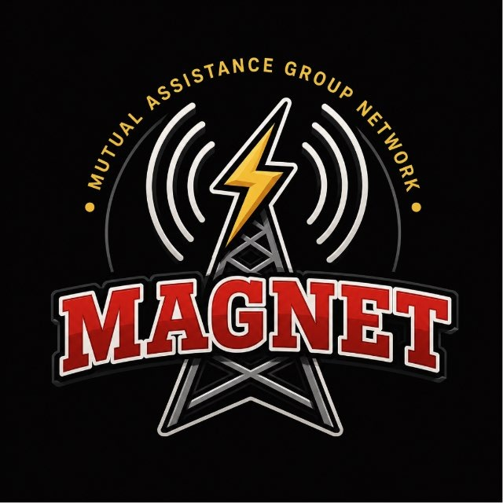

# SpotterX — MagNet Edition

A companion to JS8Call for mapping, messages, forms, and station awareness. **MAGNET-HF is the primary home for SpotterX.**

**[Releases](https://github.com/Magnet-HF/SpotterX/releases)** · **[Setup & compatibility](docs/setup.md)** · **[Report an issue](https://github.com/Magnet-HF/SpotterX/issues)** · **[MagNet tool page](https://magnet-hf.github.io/software/spotterx/)**

## Project status

This repository establishes the dedicated project home. The original MagNet package is available at the [legacy SpotterX-v4.0 release](https://github.com/Magnet-HF/Mag-Windows/releases/tag/SpotterX-v4.0) until its verified copy is published here. Existing download URLs will remain available.

## Capabilities

The published MagNet release describes station mapping, map pins, MCForms, offline mapping resources, and diagnostics. Consult the notes accompanying your build for its actual capabilities and dependencies.

## Attribution and source

SpotterX is the MagNet version of JS8Spotter, originally created by KF7MIX. The existing package includes Python source and [an MIT license notice](docs/package/LICENSE.txt), preserved here without changes alongside its original guides. This notice records upstream credits and included components; it is not a new blanket license over every bundled asset. The complete release archive is preserved byte-for-byte.

The developer should establish the authoritative working source tree, dependency notices, and build instructions in this repository. The release's bundled runtime, maps, and databases are not expanded into Git history.

## Contributing

Report the SpotterX version, JS8Call edition/version, operating system, expected behavior, actual behavior, and reproduction steps. Remove credentials and private information from diagnostic files.
